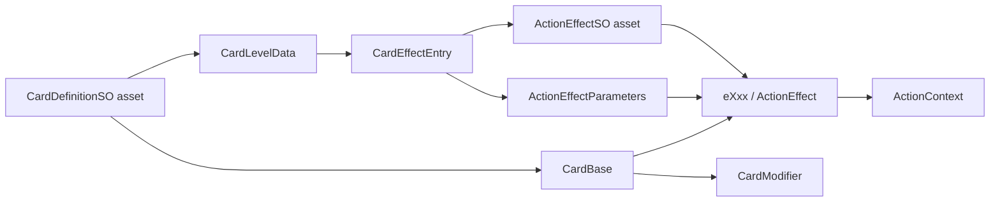

# Card Architecture

## 概要

カードは、Unity上で編集する定義データと、戦闘中に使用するランタイム状態を分離して管理する。

- `CardDefinitionSO`: カード名、説明、コスト、クールタイム、レベルごとの効果定義を持つアセット型。
- `CardEffectEntry`: 効果定義アセットと、そのカード・レベル固有のパラメータを組にして保持する。
- `ActionEffectSO`: `eXxx` の実行時効果を生成する効果定義アセット型。
- `ActionEffect` / `eXxx`: 戦闘中の実行可否と実行処理を持つランタイム効果。
- `CardBase`: `CardDefinitionSO` から生成されるランタイムカード。レベル、エンチャント、残りクールタイム、実行時効果を保持する。
- `CardModifierSO` / `CardModifier`: カード固有または報酬由来の追加効果を定義・実行する。

効果クラスは `eXxx`、効果定義型は `XxxEffectSO` の形式で命名する。

## ディレクトリ構成

```text
Assets/
├── Code/
│   ├── Runtime/
│   │   ├── Actions/
│   │   │   ├── Core/          ActionContext、ActionEffect
│   │   │   └── Effects/       eMove、eLineAttack、eApplyStatus など
│   │   └── Cards/
│   │       └── Core/          CardBase、CardModifier
│   └── Definitions/
│       ├── Actions/Effects/   ActionEffectSO、XxxEffectSO
│       └── Cards/             CardDefinitionSO、CardModifierSO
└── GameData/
    ├── Cards/                 MoveCard.asset などのカード定義アセット
    ├── Effects/               MoveEffect.asset などの効果定義アセット
    └── CardModifiers/         Modifier定義アセット
```

## 依存関係



## カード生成と使用

1. `CardDefinitionSO` のレベルデータが、`CardEffectEntry` のリストを保持する。
2. `CardBase` はカード定義とレベルから生成される。
3. `CardBase` は各 `CardEffectEntry` に対して、効果定義アセットとカード側パラメータを渡し、実行時の `eXxx` を生成する。
4. カード使用時、`CardBase.Effects` の各Effectを順番に実行する。
5. コスト、クールタイム、エンチャント処理は `CardBase` と `CardModifier` が担当する。

### MODへ渡す命中先

`eMagicArrow` は実際に命中したユニットを `ActionContext.SetHitTarget` へ記録する。空振りでは `null` を記録する。`CardModifierContext.TargetUnit` はこの命中結果を優先するため、空きマスで方向を指定した場合も「過熱」などの対象が命中したユニットと一致する。

命中結果を記録しない既存Effectでは、従来どおり指定セルのユニットを参照する。

## 効果の実装方針

- カード効果の最小単位は `eXxx` とする。
- 既存の `eXxx` と `XxxEffectSO` で表現できる場合は再利用し、カードごとの専用Effectを安易に追加しない。
- カードの発動効果は、可能な限り複数の既存Effectを `effects` に組み合わせて構成する。
- 新しいEffectは、既存Effectの組み合わせでは表現できない最小の効果単位が必要な場合だけ追加する。
- `eXxx` は具体カードを参照しない。カード固有の数値は `CardEffectEntry.parameters` に置く。

## 新規カード追加手順

1. 既存Effectの組み合わせで表現できるか確認する。
2. 必要なEffectがなければ、最小単位の `eXxx`、対応する `XxxEffectSO`、および効果定義アセットを追加する。
3. `Assets/GameData/Cards/` に `CardDefinitionSO` のカード定義アセットを作成または編集する。
4. レベルごとの `effects` に効果定義アセットを設定し、カード固有パラメータを設定する。
5. 使用可能にする場合は、対応する初期デッキ、報酬プール、ショップなどのカード一覧へ追加する。
